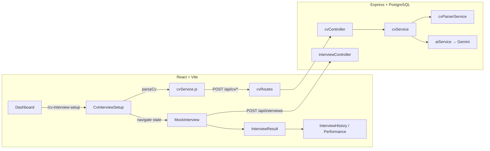
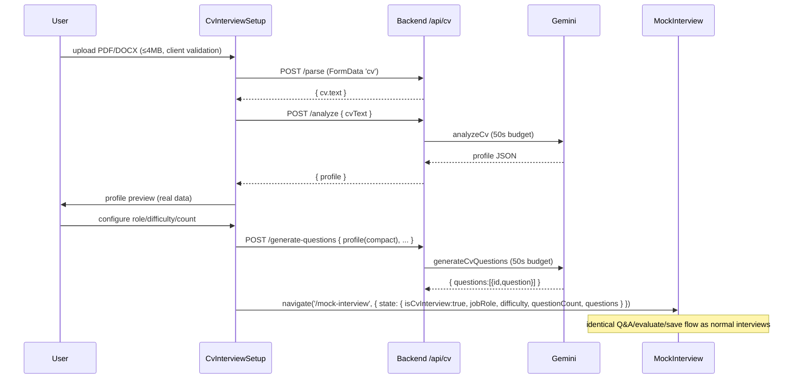

# CV-Based Mock Interview — Technical Documentation

This document describes the CV-based mock interview feature: upload a CV (PDF/DOCX), extract text, analyze it with AI into a structured profile, preview the profile, configure the interview, generate personalized questions, and take the interview through the **existing** MockInterview → evaluation → result → history pipeline shared with normal interviews.

> Scope note: interview-type persistence (`interview_type` column / `isCvInterview` in history) was implemented and reverted during development. The route-state flag `isCvInterview` **is** present in `CvInterviewSetup.jsx`/`MockInterview.jsx`/`InterviewResult.jsx` for in-session UI badges, but it is **not persisted to the database** in the current working tree. See [Interview Data Flow](#5-interview-data-flow) for details.

## Table of Contents

1. [Architecture](#1-architecture)
2. [API Reference](#2-api-reference)
3. [AI Integration](#3-ai-integration)
4. [Interview Data Flow](#4-interview-data-flow)
5. [Testing Guide](#5-testing-guide)
6. [Deployment & Troubleshooting](#6-deployment--troubleshooting)

---

## 1. Architecture

### Overview



### Component map

| Layer | File | Responsibility |
|---|---|---|
| Frontend service | `frontend/src/services/cvService.js` | `parseCv`, `analyzeCv`, `generateCvQuestions` — fetch wrappers, auth headers, defensive JSON parsing |
| Frontend page | `frontend/src/pages/CvInterviewSetup.jsx` | 5-step wizard: upload → analyzing → preview → config → generate |
| Frontend styles | `frontend/src/styles/CvInterviewSetup.css` | Wizard/upload/profile/config styles, progress bar |
| Backend routes | `backend/src/routes/cvRoutes.js` | `POST /parse`, `/analyze`, `/generate-questions`, all behind `authMiddleware` |
| Backend controller | `backend/src/controllers/cvController.js` | Thin handlers → `cvService` |
| Backend upload mw | `backend/src/middleware/cvUploadMiddleware.js` | Multer memory storage, 4 MB limit, field name `cv` |
| Backend parser | `backend/src/services/cvParserService.js` | Magic-byte type detection, PDF (`unpdf`, dynamic import) / DOCX (`mammoth`) extraction |
| Backend CV service | `backend/src/services/cvService.js` | `processCvUpload`, `analyzeCvText`, `generateCvInterviewQuestions`, `hasProfileContent` validation, `compactCvProfile` |
| Backend AI service | `backend/src/services/aiService.js` | `generateContentWithFallback` (shared deadline), `analyzeCv`, `generateCvQuestions`, schemas, `normalizeCvProfile` |
| Interview flow (shared) | `MockInterview.jsx`, `interviewService.js`, `interviewController/Service/Model` | Unchanged — CV questions reuse the same `{id, question}` contract |

### Key design decisions

- **CV text/profile never persisted** — processed in memory only; no localStorage/sessionStorage writes, no logging of CV content.
- **Sample preview isolation** — `SAMPLE_PROFILE` is render-only fallback; `cvProfile` state holds real analysis only; banner shows when `cvProfile` is null.
- **Generation-only compaction** — `compactCvProfile()` shrinks the profile JSON (~120 KB cap → ~30–40 KB) sent to Gemini for question generation; the full profile still drives the preview.
- **Shared interview pipeline** — CV questions are identical in shape to normal ones, so `MockInterview`, evaluation, result, and history work unchanged.

---

## 2. API Reference

Base: `{VITE_API_URL}/api/cv` (frontend) → backend mounts at `/api/cv`. **All endpoints require `Authorization: Bearer <JWT>`** (`authMiddleware`).

### `POST /api/cv/parse`

Upload and extract text.

- **Request**: `multipart/form-data`, field `cv` (PDF or DOCX, ≤4 MB)
- **Response 201**: `{ success, message, cv: { fileName, type, pageCount, characterCount, wordCount, text } }`
- **Errors**: 400 no file / unsupported type / spoofed MIME · 413 oversized · 422 no readable text (e.g., scanned PDF)
- **Files**: `cvController.parseCv` → `cvService.processCvUpload` → `cvParserService.parseCvFile` (magic-byte detection: `%PDF` header, `PK` zip signature; MIME must be consistent unless `application/octet-stream`/empty)

### `POST /api/cv/analyze`

Extract structured profile from CV text.

- **Request**: JSON `{ "cvText": "<extracted text>" }` (≤50,000 chars)
- **Response 200**: `{ success, message, profile }` — normalized 8-section profile (see §3)
- **Errors**: 400 missing/short text · 413 >50k chars · 502 invalid AI JSON · 500/503/504 upstream AI failures
- **Files**: `cvController.analyzeCv` → `cvService.analyzeCvText` → `aiService.analyzeCv`

### `POST /api/cv/generate-questions`

Generate personalized interview questions.

- **Request**: JSON `{ profile, jobRole?, difficulty?, questionCount? }`
  - `profile`: normalized CV profile object (required, must have meaningful content, serialized ≤120,000 chars)
  - `jobRole`: optional string ≤100 chars (omit/empty = auto-detect)
  - `difficulty`: optional string ≤30 chars
  - `questionCount`: integer 1–20 (default 5)
- **Response 200**: `{ success, message, questions: [{ id, question }] }`
- **Errors**: 400 invalid/missing profile or bad count · 413 profile too large · 502 bad AI format · 500/503/504 upstream
- **Files**: `cvController.generateCvQuestions` → `cvService.generateCvInterviewQuestions` (validation + `compactCvProfile`) → `aiService.generateCvQuestions`

---

## 3. AI Integration

### Model configuration (`aiService.js`)

| Setting | Value |
|---|---|
| Env var | `GEMINI_API_KEY` (required; missing → 500 "Gemini API key is not configured"), `GEMINI_MODEL` (optional override) |
| Primary model | `gemini-3.5-flash-lite` (or `GEMINI_MODEL`) |
| Fallback model | `gemini-3.8-flash` |
| Thinking | `minimal` (primary) / `low` (fallback — `gemini-3.8-flash` rejects `minimal`) |

### `generateContentWithFallback(prompt, { maxOutputTokens, responseJsonSchema, timeoutMs })`

- **Shared deadline**: `deadline = Date.now() + timeoutMs`; each attempt gets `AbortSignal.timeout(remainingMs)` — total chain time never exceeds `timeoutMs`.
- **Default budget**: 25 s (question generation, evaluation). **CV calls**: `analyzeCv` and `generateCvQuestions` pass `timeoutMs: 50000`.
- **Retryable statuses**: 429, 503 only → warn + try next model.
- **Timeout handling**: `AbortError`/`TimeoutError` → `504 "AI request timed out after Xms across all models."`; deadline exhausted before an attempt → same 504.
- **Non-retryable errors** (e.g., 400) rethrow unchanged.

### CV profile normalization (`normalizeCvProfile`)

Returns fixed 8-field shape: `personalSummary` (string), `technicalSkills`/`softSkills`/`otherSkills` (string arrays), `projects`, `workExperience`, `education`, `certifications` (object arrays with bounded string fields). Malformed values → empty strings/arrays.

### `hasProfileContent` (cvService.js)

Rejects profiles with no usable content: `personalSummary` must be non-empty; string arrays need ≥1 non-empty trimmed string; object arrays need ≥1 object with meaningful string or string-array fields.

### `compactCvProfile` (cvService.js)

Generation-only shrink before the AI call (original profile untouched):

- `personalSummary` ≤600 chars; skill lists ≤40/30/30 items ×80 chars
- Projects ≤8 (name 120, description 400, technologies 15×60, responsibilities/achievements 6×160)
- Work experience ≤8, education ≤6, certifications ≤8 with per-field caps
- Empty/malformed entries dropped; result typically ~30–40 KB

### Response validation

- `responseMimeType: "application/json"` + `responseJsonSchema` (`CV_PROFILE_SCHEMA`, `QUESTIONS_SCHEMA`, `EVALUATION_SCHEMA`)
- `parseJsonResponse` strips markdown fences; invalid JSON → 502
- `generateCvQuestions` requires `data.questions` array; page additionally filters to objects with non-empty `question` strings

---

## 4. Interview Data Flow

### CV flow



### Normal flow (unchanged)

`InterviewSetup` → `POST /api/ai/generate-questions` → same `/mock-interview` route state **without** `isCvInterview`.

### Shared downstream

- `MockInterview.jsx` reads `location.state` (or restores `activeInterviewSession` from localStorage) → per-question 120 s timer → `evaluateAnswer` → `POST /api/interviews/evaluate` → on completion `POST /api/interviews` + `POST /api/interviews/:id/answers` → `/interview-result`.
- `isCvInterview` (route state only) shows a "CV-based" badge in MockInterview/InterviewResult headers — **not persisted**.

### Interview type persistence status

An `interview_type` column implementation (model/service/frontend badges in History/Performance) was built and **reverted**; it is not in the working tree. If reintroduced it requires:

```sql
ALTER TABLE interviews ADD COLUMN interview_type VARCHAR(20) NOT NULL DEFAULT 'normal';
```

Legacy rows default to `'normal'` automatically.

---

## 5. Testing Guide

### Frameworks

- **Backend**: `node:test` + `node:assert` — zero new dependencies (`backend/tests/cv-interview.test.js`)
- **Frontend**: `vitest` + `@testing-library/react` + `jsdom` (`frontend/vitest.config.js`, `frontend/src/test/`)

### Commands

```bash
cd backend  && npm test        # node --test "tests/**/*.test.js"
cd frontend && npm test        # vitest run
cd frontend && npm run build
```

### Mocking strategy

- Gemini: fake `GoogleGenAI` injected via `require.cache` before `aiService` loads; per-test behavior switch (success / 503 / AbortError / bad JSON)
- `cvService` AI calls: `aiService.analyzeCv`/`generateCvQuestions` exports stubbed to capture arguments (verifies compaction without network)
- Frontend: `vi.mock("../services/cvService")` + mocked `useNavigate`; `fetch` stubbed in service tests
- `VITE_API_URL=http://api.test` set in `vitest.config.js`; `GEMINI_API_KEY=test-key-not-real` set in backend test file

### Coverage

Parser (PDF valid/unsupported/spoofed/missing/image-only), analysis validation, question-gen validation + 120 KB limit + compaction + auto-detect, AI fallback (503→success, both-503, AbortError→504, 400 passthrough, malformed JSON→502), errorHandler status mapping, cvService endpoints/headers/error propagation, wizard UI (file validation, default Easy, difficulty switching, full flow navigation, parse-failure recovery).

### Limitations

- No live Gemini or real-DB tests (by design)
- Valid-DOCX parse test skipped (needs a real OOXML fixture)
- Interview-type persistence test skipped (feature reverted)
- History/Performance badge rendering not component-tested

---

## 6. Deployment & Troubleshooting

### Deployment relationship

- **Backend** → Vercel serverless: `backend/api/index.js` loads `src/server.js`; `vercel.json` rewrites all routes → `/api/index.js`, `functions."api/**".maxDuration = 60`.
- **Frontend** → Vercel static; `VITE_API_URL` must point at the backend deployment.
- Backend production branch = `main`; feature work merges via PRs.

### Required environment variables

| Var | Where | Purpose |
|---|---|---|
| `GEMINI_API_KEY` | backend (Vercel) | Gemini auth — missing → 500 |
| `GEMINI_MODEL` | backend (optional) | Override primary model |
| `DB_HOST/DB_PORT/DB_NAME/DB_USER/DB_PASSWORD` | backend | PostgreSQL |
| `JWT_SECRET` | backend | Auth tokens |
| `FRONTEND_URL` | backend (optional) | CORS allowlist |
| `VITE_API_URL` | frontend build | API base URL |

### Common errors

| Symptom | Likely cause | Check |
|---|---|---|
| 401 | Missing/expired JWT | `localStorage.token`; `authMiddleware` |
| 413 | File >4 MB (multer) or CV text >50k / profile >120k | Client validation should prevent; check limits |
| 429/503 | Gemini capacity | Automatic fallback; retry later; check both models in logs (`[aiService] ... falling back`) |
| 504 | AI timeout (25 s default / 50 s CV) | Shared deadline exceeded; Vercel maxDuration 60 s |
| 500 "Internal server error" | Error without `statusCode`/valid `status` | Check Vercel runtime logs (`errorHandler` logs method+URL+error) |
| `FUNCTION_INVOCATION_FAILED` | Module-load crash (e.g., ESM `require`) | `unpdf` fixed via dynamic `import()` — keep CJS-safe |
| `Cannot POST /api/cv/...` | Route not deployed | Verify `main` contains `cvRoutes` mount |

### Safe production verification

```bash
curl -i https://<backend>/api/cv/parse          # expect 401 (auth) not 404/500
curl -i -X POST https://<backend>/api/auth/login # expect 400, not 500
```

Never send real CV data or tokens in verification requests.

---

## Related docs

- `docs/api-design.md` — overall API conventions
- `docs/database-design.md` — schema (note: `interview_type` column not currently present)
- `README.md` — project setup
